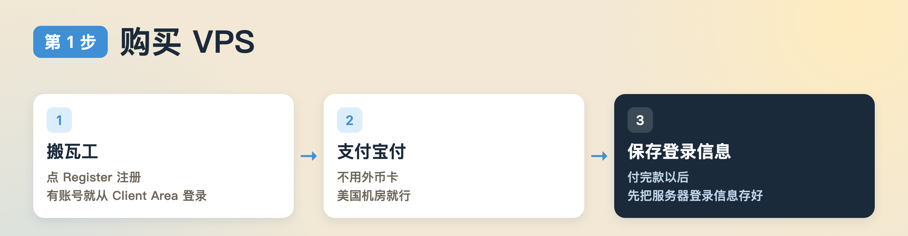
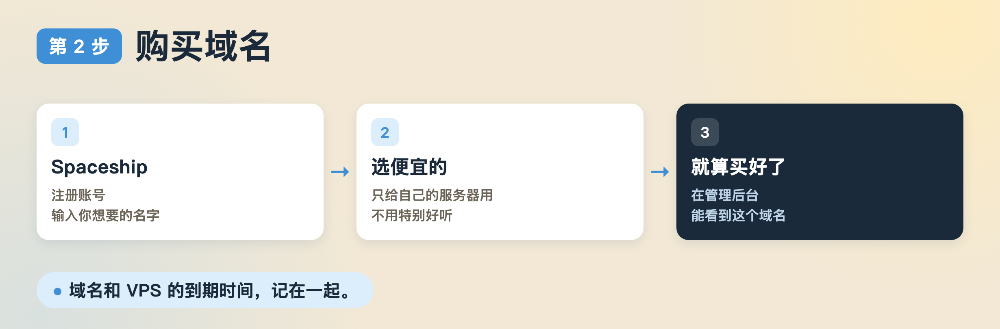
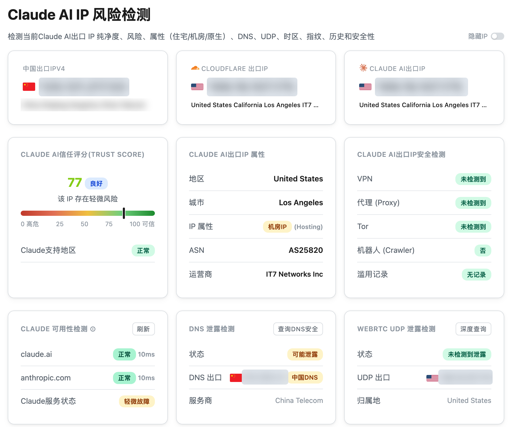

# 国外 AI 工具网络环境笔记

> **声明**
>
> 本仓库是个人学习笔记，免费公开，仅供学习和技术交流。
>
> 作者不提供、不出售任何代理服务、节点、账号、代搭、代充或付费咨询，也不从文中提到的任何服务获得佣金或返利。
>
> 请在遵守所在地法律法规的前提下阅读和使用，不得用于任何违法用途。使用本仓库内容产生的一切后果，由使用者自行承担。
>
> 文中提到的第三方服务都由其自行运营，与作者无关，作者不对它们的稳定性、安全性和合规性负责。

这一篇只讲用 Claude 最关键的一块：网络。设备、账号、支付不在这里。

## 怎么用这个仓库

你可以自己照着配，但不建议。

建议的做法：下载 DeepSeek Harness（DeepSeek 官方的 AI 智能体，国内直接能用），把本仓库的链接发给它，让它根据你的情况一步步带你配。

- 下载：https://www.deepseek.com/harness/ （Mac 只支持 M 系列芯片，Windows 要 64 位）
- 它要用 DeepSeek 的 API 密钥：在 https://platform.deepseek.com/ 注册，充几块钱，创建一个密钥，填进它的设置里。

已经能用上 Codex 的，也可以直接用 Codex，做法一样：把本仓库的链接发给它。

## 为什么网络最关键

Claude 判断你在不在中国，主要看四样东西：网络、设备、账号、支付。其中最核心的是网络。

Claude 能识别你访问它时用的网络，用国内网络直接上，基本一用就封。

所以用国外 AI，大家通常会用一个代理节点把原来的网络换掉，也就是常说的梯子。

常见的做法有两种：一种是买现成的机场，另一种是自己搭节点。

- **机场**：便宜、方便，但不干净，容易封号。很多人挤在同一条线路上，只要有一个人被封，大家一起连带。低价机场的线路质量也参差不齐，稳定性没保障。
- **自建 VPS 节点**：如果机场像坐大巴，自建节点就像自己开车。线路自己选，车里只有你一个人，最干净、最安全，也是用 Claude 的高手们普遍在用的办法。

---

## 三个量级，按需要选

不同的 AI，对网络的要求不一样。Codex、Gemini、Grok 这些相对宽松；Claude 风控最严，网络不干净很容易封号。按你要用的来选，不用一上来就花大钱。

| 量级 | 适合谁 | 参考价 | 稳定度 |
|---|---|---|---|
| 量级一：现成线路 iKuuu | 只用 Codex、Gemini、Grok | 约 12 元/月 | ★ |
| 量级二：更稳的线路 Equal（Max 套餐） | 用 Claude，只开 Pro | 78 元/月 | ★★ |
| 量级三：自己搭节点（搬瓦工） | 用 Claude，要开 Max 或 Ultra | 约 200 元/月 | ★★★ |

大多数人用量级一或量级二就够了，量级三用到的人很少。量级二基本不会封号，已经很稳定，只是偶尔可能罢工；量级三非常稳定。

**建议从量级一开始，一、二、三依次递进。** 跳着来可能会引发一些意想不到的问题。用量上来了，再往上升级就好。

下面挨个讲每个量级怎么做，每个量级都是完整的一套，选好以后只看那一块就行。

---

## 量级一：只用 Codex、Gemini、Grok

**适用**：不用 Claude，只用 Codex、Gemini、Grok 这些。

**价格**：约 12 元一个月。

**做法**：打开官网注册、充值，按它的说明下载客户端、导入订阅，直接用就行，不用做别的配置。

https://ikuuu.foo/

**完成标准**：Codex、Gemini、Grok 能正常打开使用。

---

## 量级二：用 Claude，只开 Pro

**适用**：要用 Claude，只打算开 Pro 会员。基本不会封号，已经很稳定，只是偶尔可能罢工。

**价格**：买最高的 Max 套餐，78 元一个月。

**做法**：下面 3 步。

### 第 1 步：买套餐，跟着它的教程装好

打开官网买 Max 套餐：

- 海外地址：https://www.equaldcdn.com/
- 国内地址：https://www.ipequal.com/

买完以后，里面有很完善的教程，下载客户端、导入订阅，跟着做就行。

### 第 2 步：开分流

它的教程里只缺分流。用下面现成的规则，把链接发给 AI，让它帮你在电脑和手机上配好：国内网站直连，Claude 和其他国外服务走代理。

- 电脑规则：https://github.com/Loyalsoldier/clash-rules
- 手机规则：https://github.com/Johnshall/Shadowrocket-ADBlock-Rules-Forever ，选国内外划分加去广告的那一份

### 第 3 步：测一下 IP

用 https://ip.net.coffee/claude/ 在电脑和手机上各测一遍，主要看出口是不是美国、有没有泄露。看不懂结果的，截图交给 AI。

**完成标准**：电脑和手机都能正常打开国内外网站，IP 检测没有明显问题。

---

## 量级三：用 Claude，要开 Max 或 Ultra

**适用**：要用 Claude，打算开 Max 或 Ultra，长期用。自己搭节点，线路只有你一个人用，非常稳定。

**价格**：约 200 元一个月（服务器），外加一个域名，一年几块到几十块。

**做法**：下面 5 步，买 VPS、买域名、让 AI 带你装节点、配置电脑和手机的分流、测 IP。

### 第 1 步：购买 VPS

VPS 就是一台租在海外的服务器，用来搭自己的节点。

**要用 Claude，机房一定选美国。** 香港等地区不在 Claude 支持的范围里，买了也用不了。

推荐搬瓦工，价格贵一点，但线路稳定：

| 项目 | 搬瓦工 |
|---|---|
| 官网 | https://bandwagonhost.com |
| 参考配置 | E-Commerce VPS → Los Angeles → USCA_9，季付 |
| 参考价 | 89.99 美元/季度（约 600 元，折合每月约 200 元） |
| 付款方式 | 支付宝 |

价格是 2026 年 11 月 24 日查的，以下单页为准。这个配置最便宜的一档是 SPECIAL 40G KVM PROMO V5 - CN2 GIA ECOMMERCE（3 核 CPU、2GB 内存、40GB 硬盘、每月 2000GB 流量），个人用够了。

付完款以后，把服务器的 IP、登录端口和密码保存好。

**完成标准**：VPS 购买成功，能进入服务器后台。

### 第 2 步：购买域名

域名只是给服务器当个入口，不需要好听，选个便宜、好管理的就行。

国外平台，能打开的话优先用：

- Spaceship：https://www.spaceship.com ，便宜的后缀第一年一两美元。
- Porkbun：https://porkbun.com ，一年 11 美元左右。

国外网站打不开的，用国内平台：

- 阿里云：https://wanwang.aliyun.com/domain/
- 腾讯云：https://dnspod.cloud.tencent.com/

国内平台要先完成实名认证，审核通过以后解析才会生效。服务器在国外，不用备案。

**完成标准**：域名购买成功，能在管理后台看到。

### 第 3 步：（AI 做）安装节点

- 脚本仓库：https://github.com/mack-a/v2ray-agent
- 出了问题看这篇：https://www.v2ray-agent.com/archives/1684115970026

把这两个链接发给 AI，告诉它你的 VPS 和域名，让它带你从域名解析、防火墙一直装到节点。协议选 VLESS+TLS_Vision+TCP，命令和密码你自己在服务器上输入。

**完成标准**：安装完成，脚本输出了节点信息。

### 第 4 步：（AI 做）电脑和手机的分流

- 电脑客户端 Clash Verge Rev：https://github.com/clash-verge-rev/clash-verge-rev/releases/latest
- 手机客户端小火箭（Shadowrocket），美区 App Store 付费下载。
- 手机分流规则：https://github.com/Johnshall/Shadowrocket-ADBlock-Rules-Forever ，选国内外划分加去广告的那一份。

把这几个链接发给 AI，让它带你把节点导入电脑和手机，配好分流：国内网站直连，Claude 和其他国外服务走你自己的节点。电脑上用脚本生成的 ClashMeta 订阅，本身就带分流规则。生成订阅时脚本会用到一个新端口，让 AI 在防火墙里把它也放行，不然电脑导入订阅会失败。

订阅链接和节点链接别发到任何公开的地方，别人拿到就能用你的节点。

**完成标准**：电脑和手机都能正常打开国内外网站，日常用规则模式。

### 第 5 步：测一下 IP 干不干净

检测网址：https://ip.net.coffee/claude/

电脑和手机各打开测一遍，主要看四个地方：

1. 最上面不要出现 IPv6 的提示。
2. 最上面一行，后两个地址要一致，而且是美国。第一个是国内出口，规则模式下国内网站本来就直连，显示国内 IP 是正常的。
3. AI 信任评分尽量在 80 分以上，低一点问题也不大。
4. 下面的泄露检测里，WebRTC 这一项不要出现中国。DNS 这一项显示可能泄露的情况比较常见，可以让 AI 帮你看看要不要处理。

下面是一个检测结果的示例，IP 已经打码：

哪一项不对，就把检测结果截图交给 AI，让它帮你查是哪里漏了。

**完成标准**：电脑和手机的 IP 检测都没有明显问题。

---

网络这一块到这里就完成了。
